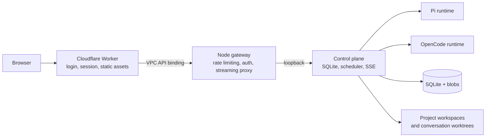

# Workbench

**A self-hosted workbench for running coding agents against your projects.**

[](https://github.com/lowlune/workbench/actions/workflows/ci.yml)
[](https://github.com/lowlune/workbench/releases)

Workbench combines a browser console with a durable control plane for coding-agent conversations. It runs the [Pi](https://github.com/badlogic/pi-mono) and OpenCode engines, streams live updates to the UI, and keeps conversation state and queued work on a Linux host you control.

## What it does

- Runs Pi and OpenCode conversations from one web console.
- Queues commands durably and schedules independent conversations with configurable concurrency and memory headroom.
- Streams activity and transcript updates over Server-Sent Events (SSE), while persisting conversation state in SQLite.
- Uses a separate Git worktree per conversation for Git-backed build work. Non-Git workspaces run in place; the General workspace has its own data directory.
- Supports attachments, tool output, usage tracking, notifications, pause/resume, cancellation, and explicit worktree apply/discard flows.
- Serves the console through a Cloudflare Worker and connects it to the host through a VPC service binding.

## Architecture



The gateway listens on `127.0.0.1:8787` by default and the control service on `127.0.0.1:8788`. The control port is intended to remain private. The Cloudflare Worker serves static assets and forwards API requests to the gateway through the configured VPC service.

See [ARCHITECTURE.md](ARCHITECTURE.md) for the detailed run lifecycle, persistence model, sandbox boundary, and operational behavior.

## Requirements

- Linux host for the intended sandboxed deployment, with `bubblewrap` available.
- Node.js `>=22.12` and npm.
- A configured Pi runtime and, if used, an OpenCode executable on the host.
- For the hosted edge setup: a Cloudflare account with Workers and VPC Services configured.

The sandbox is enabled by default. `WORKBENCH_SANDBOX=off` runs agents directly on the host and removes the sandbox boundary; use it only when you intentionally accept that access level.

## Local development

Install the locked dependencies and run the safe checks:

```bash
npm ci
npm run check
npm test
```

The Vite development server proxies API requests to the local gateway. Run the control service and gateway in separate terminals, then start Vite in a third terminal. Set the same values in both service terminals:

```bash
export WORKBENCH_PROXY_KEY="$(openssl rand -hex 32)"
export WORKBENCH_LOGIN="replace-with-a-strong-local-password"
export WORKBENCH_SESSION_SECRET="$(openssl rand -hex 32)"
export WORKBENCH_DATA="$HOME/.local/share/workbench-dev"
export WORKBENCH_PROJECT_ROOTS="$HOME/projects"
npm run start:control
```

In a second terminal, load those same environment values and run:

```bash
npm start
```

Then, in a third terminal:

```bash
npm run dev
```

Open `http://127.0.0.1:5173`. Keep the proxy key, login password, and session secret private. For a persistent deployment, supply them through a protected service environment or the host's existing secret store, not a committed file.

### Configuration

| Variable | Purpose | Default |
| --- | --- | --- |
| `WORKBENCH_PROXY_KEY` | Shared internal key for the Worker/gateway/control path; required by the control service. | Required |
| `WORKBENCH_LOGIN` | Password accepted by the login screen. | Required for authenticated access |
| `WORKBENCH_SESSION_SECRET` | Signs browser sessions. | Required for authenticated access |
| `WORKBENCH_PROJECT_ROOTS` | Colon-separated roots the control plane may expose as workspaces. | `$HOME/projects` |
| `WORKBENCH_DATA` | Runtime database, blobs, and control state directory. | `./data` |
| `WORKBENCH_MAX_RUNS` | Default maximum number of resident runs (clamped to 1–8). | `2` |
| `WORKBENCH_SANDBOX` | Agent process isolation. `off` disables it. | Enabled |
| `PORT` / `WORKBENCH_CONTROL_PORT` | Gateway and control loopback ports. | `8787` / `8788` |
| `WORKBENCH_OPENCODE_BIN` | Optional path to the OpenCode executable. | Resolved from `PATH` |

The Worker and host must use the same `WORKBENCH_PROXY_KEY`. Configure Worker secrets with Wrangler rather than placing values in `wrangler.jsonc`.

## Cloudflare deployment

1. Copy `wrangler.example.jsonc` to `wrangler.jsonc` and set the VPC service ID for your gateway. The local `wrangler.jsonc` is ignored by Git.
2. Authenticate with Wrangler or configure `CLOUDFLARE_ACCOUNT_ID`.
3. Set the Worker secrets:

   ```bash
   npx wrangler secret put WORKBENCH_LOGIN
   npx wrangler secret put WORKBENCH_SESSION_SECRET
   npx wrangler secret put WORKBENCH_PROXY_KEY
   ```

4. Build, validate, and deploy the Worker:

   ```bash
   npm run deploy
   ```

`npm run build` verifies staged asset references, promotes the new index atomically, and retains old immutable bundles for seven days so already-open clients can finish loading their chunks. `npm run deploy:dry` performs the build and a Wrangler dry run. `npm run deploy:alias` deploys the compatibility redirect Worker.

## Checks and tests

```bash
npm run check       # syntax, runtime checks, TypeScript, UI asset references
npm test            # unit and isolated integration tests
npm run build       # TypeScript + Vite build + validated asset promotion
```

`npm run test:runtime`, `npm run test:ui`, and `npm run test:edge` exercise a running service and may create conversations or agent runs. Run them only against a dedicated test environment. They are intentionally not part of the default CI job.

## Repository layout

| Path | Contents |
| --- | --- |
| `src/` | React console and UI components |
| `server/` | Node gateway, control plane, scheduler, runtime adapters, and persistence |
| `shared/` | Authentication and protocol helpers shared across runtimes |
| `worker.js` | Cloudflare Worker entry point |
| `worker-alias.js` | Compatibility redirect Worker |
| `public/` | Login/static files and immutable UI build assets |
| `scripts/` | Build, asset validation, backup, and test tools |
| `ARCHITECTURE.md` | Current system architecture and security details |
| `docs/archive/` | Historical plans and completed audit snapshots |
| `plans/` | UI polish plans and implementation records |

## License

This repository currently has no license file. Contact the repository owner before reusing or redistributing the code.
